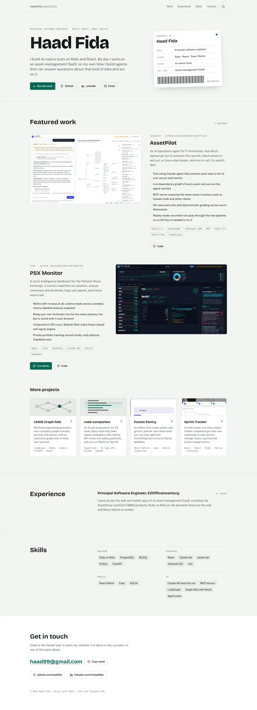
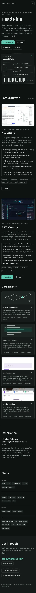

# haadfida.github.io

Source for Haad Fida's portfolio site, served at <https://haadfida.github.io>.

It is a single page: a hero, two featured projects (AssetPilot and PSX Monitor), a grid of smaller
projects, experience, skills and contact details. It works in light and dark themes (following the
system setting, with a toggle in the header) and respects `prefers-reduced-motion`.

| Desktop | Mobile |
| --- | --- |
|  |  |

More captures: [`docs/desktop-dark.webp`](docs/desktop-dark.webp), [`docs/mobile.webp`](docs/mobile.webp).

## Stack

Vite, React 19, TypeScript, Tailwind CSS 3, Framer Motion (`LazyMotion`, used only for the hero entrance)
and lucide-react icons. Fonts are self-hosted through Fontsource: Bricolage Grotesque, Public Sans and
IBM Plex Mono.

## Run it

Needs Node 20 or newer.

```sh
npm install
npm run dev        # http://localhost:5173
npm run build      # type-checks and writes dist/
npm run preview    # serves dist/ at http://localhost:4173
npm run lint
```

## Where things live

| Path | What it holds |
| --- | --- |
| `src/data/projects.ts` | Every project card, the contact links, and `DEMO_URL` |
| `src/components/` | `Header`, `Hero`, `FeaturedProjects`, `MoreProjects`, `Experience`, `Skills`, `Contact` |
| `src/index.css` | Color and type tokens for both themes |
| `src/assets/` | Project screenshots as WebP, each 150 KB or less |
| `public/` | Favicons, `og.png`, `robots.txt`, `sitemap.xml`, `.nojekyll`, `.well-known/assetlinks.json` |
| `scripts/` | Image optimisation and screenshot scripts |

### Turning on the AssetPilot demo link

`DEMO_URL` in `src/data/projects.ts` is `null`, which hides AssetPilot's **Live demo** button. Set it to
the deployed URL and the button appears.

### Adding or replacing a screenshot

```sh
npm run images -- path/to/screenshot.png   # writes src/assets/<name>.webp and <name>-700.webp
```

The script resizes to at most 1400px wide and lowers WebP quality until the file is 150 KB or less. It
also writes a 700px copy used in `srcset` on small screens.

### Refreshing the README screenshots and the Open Graph image

```sh
npm run build && npm run preview &
npm run screenshots     # SITE_URL defaults to http://localhost:4173/
```

This writes `docs/*.webp` and `public/og.png` (1200x630, taken from the hero). It uses `playwright-core`
with an installed Chromium: set `CHROMIUM_PATH`, or it picks the newest one in
`~/Library/Caches/ms-playwright`. Run `npm run build` again afterwards so `dist/` has the new `og.png`.

## Deploy

The site is served from the root of `haadfida.github.io`, so `vite.config.ts` uses `base: '/'`.

```sh
npm run deploy
```

This builds, then uses `gh-pages` to push `dist/` to the `master` branch of
`https://github.com/haadfida/haadfida.github.io.git`. `--dotfiles` is set so `.nojekyll` and
`.well-known/assetlinks.json` (the Android app link for `com.haad.cv`) are published too. You need push
access to that repository.

The `gh-pages` branch of this repository holds the old build from when the site lived at
`/modern-portfolio/`; the source is on `master`.
